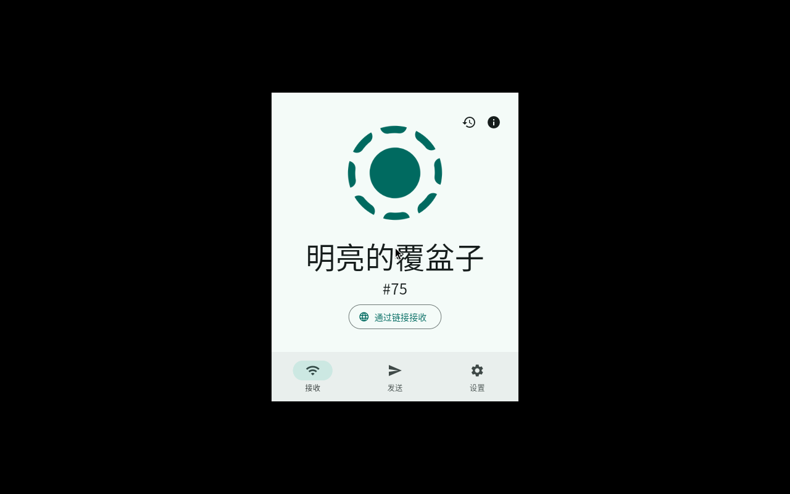

# LocalSend for RISC-V 64

**为 [localsend/localsend](https://github.com/localsend/localsend) 提供 riscv64 构建支持，含完整桌面 GUI。**

[]()
[]()
[]()
[](LICENSE)

已在 SpacemiT K3（Bianbu 4.0.1，kernel 6.18.3，riscv64）上完成端到端验证：
GUI 正常渲染、设备发现、HTTPS 传输、中文本地化，两设备间传输 MD5 一致。



---

## 快速开始

### 安装预编译包

```bash
# 完整桌面 GUI
sudo dpkg -i localsend-gui-riscv64_1.18.2_riscv64.deb
localsend-gui

# 或：终端界面 + 网页直传（不依赖 GUI）
sudo dpkg -i localsend-riscv64_1.18.2_riscv64.deb
```

| 包 | 大小 | 内容 |
|---|---|---|
| `localsend-gui-riscv64_1.18.2_riscv64.deb` | 20.1 MB | 完整桌面 GUI（Flutter AOT） |
| `localsend-riscv64_1.18.2_riscv64.deb` | 4.6 MB | `localsend-cli` 终端界面 + `localsend-link` 网页直传 |

两个包可共存，共用 53317 端口，但同一时间只能运行一个实例。

### 从源码构建

GUI 需要一个可用的 riscv64 Flutter 引擎。如果还没有，见
[flutter-riscv64-linux](https://github.com/fivif/flutter-riscv64-linux)（含预编译产物）。

```bash
# 1. 上游源码
git clone https://github.com/localsend/localsend.git
cd localsend && git checkout d11fdb1

# 2. 应用补丁
git apply <this-repo>/patches/0001-cargokit-riscv64.patch
git apply <this-repo>/patches/0002-cmake-no-error-deprecated.patch

# 3. 构建
cd app
flutter build linux --release
```

CLI 与网页直传不依赖 Flutter 引擎，只需 Rust 工具链：

```bash
./scripts/build-riscv64.sh
./scripts/package-deb.sh
```

---

## 与上游的差异

本仓库不复制上游源码。构建时从上游 clone，仅应用两个补丁。

| 补丁 | 行数 | 性质 |
|---|---|---|
| [`0001-cargokit-riscv64.patch`](patches/0001-cargokit-riscv64.patch) | +6 | cargokit 的 target 映射表缺少 riscv64 条目 |
| [`0002-cmake-no-error-deprecated.patch`](patches/0002-cmake-no-error-deprecated.patch) | +4 | 插件自带 `-Werror` 与 ayatana 的 deprecation 标记冲突 |

<details>
<summary><b>补丁 0001 中 triple 的说明</b></summary>

补丁当前使用 `riscv64a23-unknown-linux-gnu`，这是 SpacemiT 定制工具链的私有 triple。

选用它是因为板上 `rustc -vV` 报 `host: riscv64a23-unknown-linux-gnu`，且
`$(rustc --print sysroot)/lib/rustlib/` 下仅此一个 triple 有 std，系统未安装 rustup。

通用环境下应使用标准 triple `riscv64gc-unknown-linux-gnu`，见
[`patches/0003-上游建议版.md`](patches/0003-上游建议版.md)。
</details>

---

## 验证状态

### 已完成

| 项目 | 结果 |
|---|---|
| GUI 编译（debug / release） | 成功，bundle 657 MB / 66 MB |
| 窗口渲染 | 1024–1400 ms 出现，无黑屏 |
| 设备发现 | 识别对端设备（Redmi，10.5.90.193） |
| 端到端传输 | 296,031 B JPEG，双向 MD5 一致，原始 mtime 保留 |
| 中文本地化 | 设备名自动生成（「明亮的覆盆子」） |
| deb 安装 | `dpkg -i` 退出码 0，依赖零缺失，desktop 校验通过 |
| 引擎一致性 | 包内 `.so` sha256 `3dc3cde1…`，与引擎仓库的干净构建产物一致 |

### 已知限制

1. **仅验证了接收方向**：手机 → 板子。板子 → 手机的发送未测试。
2. **未测试大文件**：最大传输为 289 KB，未验证 GB 级文件。
3. **未测试多文件与目录传输**。
4. **未测试断点续传与失败重试**。
5. **托盘图标未验证**：测试环境为 Xvfb，无系统托盘。
6. **显示验证在 Xvfb + llvmpipe 下完成**：真实 Xorg / Wayland 未验证。

---

## 为什么需要这个

上游 LocalSend 的桌面 GUI 是 Flutter 应用。Flutter 官方未发布 riscv64 Linux
引擎产物（`storage.googleapis.com/flutter_infra_release/flutter/<rev>/linux-riscv64/artifacts.zip`
始终返回 404），因此在该架构上无法直接用 `flutter build linux` 构建。

本仓库解决两件事：

1. **引擎**：见 [flutter-riscv64-linux](https://github.com/fivif/flutter-riscv64-linux)，
   完成从源码构建、验证与分发。
2. **适配**：上表两处补丁，使上游源码可在 riscv64 上编译。

上游业务代码未作任何修改。

---

## 包内容

```
localsend-gui-riscv64
├── /opt/localsend-gui/                    67 MB
│   ├── localsend_app                      ELF64 RISC-V
│   ├── lib/libapp.so                      15,729,544 B  AOT 机器码
│   ├── lib/libflutter_linux_gtk.so        13,996,360 B  引擎
│   ├── lib/librust_lib_localsend_app.so   24,133,064 B  Rust core
│   └── data/icudtl.dat + flutter_assets/
├── /usr/local/bin/localsend-gui
├── /usr/share/applications/localsend-gui.desktop
└── /usr/share/icons/hicolor/256x256/apps/localsend-gui.png

localsend-riscv64
└── /usr/local/bin/{localsend-cli, localsend-link, localsend-launch, localsend-share}
```

依赖从 `readelf -d` 的 `NEEDED` 精确计算（23 个直接依赖），
另加 3 个 `dlopen` 加载的库：`libegl1`、`libgbm1`、`libsecret-1-0`。

---

## 文档

| 文档 | 内容 |
|---|---|
| [docs/01-引擎前提](docs/01-引擎前提.md) | 引擎完备性检查清单；`--local-engine` 的用途与代价 |
| [docs/02-GUI构建记录](docs/02-GUI构建记录.md) | debug 与 release 构建全过程 |
| [docs/03-deb打包](docs/03-deb打包.md) | 包结构、依赖计算、安装验证 |
| [docs/04-端到端验证](docs/04-端到端验证.md) | 传输验证的日志与数据 |
| [docs/05-踩坑清单](docs/05-踩坑清单.md) | 构建过程中的问题与解法 |
| [docs/06-引擎统一记录](docs/06-引擎统一记录.md) | Dart SDK 版本统一过程 |

---

## License

本仓库内容（补丁、脚本、文档）以 **Apache-2.0** 发布，与上游
[localsend/localsend](https://github.com/localsend/localsend) 一致。

上游源码不包含在本仓库内，请从其[官方仓库](https://github.com/localsend/localsend)获取。
