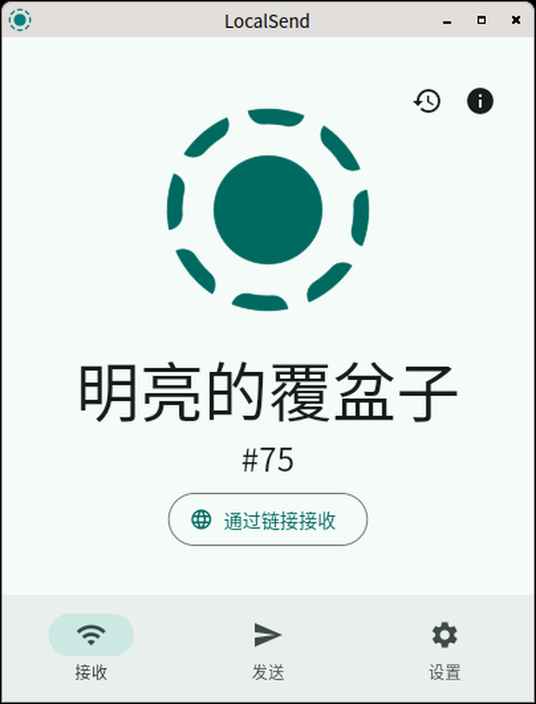

# LocalSend for RISC-V 64

LocalSend 的 riscv64 构建支持，含完整桌面 GUI。

[]()
[]()
[](LICENSE)

已在 SpacemiT K3（Bianbu 4.0.1，kernel 6.18.3）上完成端到端验证：
GUI 正常渲染、设备发现、HTTPS 传输、中文本地化，两端 MD5 一致。



## 安装

```bash
# 完整桌面 GUI
sudo dpkg -i localsend-gui-riscv64_1.18.2_riscv64.deb
localsend-gui

# 或：终端界面 + 网页直传（不依赖 GUI）
sudo dpkg -i localsend-riscv64_1.18.2_riscv64.deb
```

| 包 | 大小 | 内容 |
|---|---|---|
| `localsend-gui-riscv64` | 20.1 MB | 桌面 GUI，Flutter AOT |
| `localsend-riscv64` | 4.6 MB | `localsend-cli` + `localsend-link` |

两包可共存，共用 53317 端口，同一时间只能运行一个实例。

## 从源码构建

GUI 需要 riscv64 Flutter 引擎，该产物 Flutter 官方未发布。可用
[flutter-riscv64-linux](https://github.com/fivif/flutter-riscv64-linux) 提供的预编译包。

```bash
git clone https://github.com/localsend/localsend.git
cd localsend && git checkout d11fdb1

git apply <this-repo>/patches/0001-cargokit-riscv64.patch
git apply <this-repo>/patches/0002-cmake-no-error-deprecated.patch

cd app && flutter build linux --release
```

CLI 与网页直传不依赖 Flutter 引擎，只需 Rust 工具链：

```bash
./scripts/build-riscv64.sh
./scripts/package-deb.sh
```

## 与上游的差异

本仓库不复制上游源码，构建时从上游 clone 后应用两处补丁。上游业务代码未作修改。

| 补丁 | 行数 | 说明 |
|---|---|---|
| [`0001`](patches/0001-cargokit-riscv64.patch) | +6 | cargokit 的 target 映射表缺少 riscv64 |
| [`0002`](patches/0002-cmake-no-error-deprecated.patch) | +4 | 插件 `-Werror` 与 ayatana 的 deprecation 冲突 |

补丁 0001 中的 `riscv64a23-unknown-linux-gnu` 是 SpacemiT 工具链的私有 triple，
通用环境应改用 `riscv64gc-unknown-linux-gnu`，见 [patches/0003](patches/0003-上游建议版.md)。

## 验证状态

| 项目 | 结果 |
|---|---|
| GUI 编译（debug / release） | 成功，bundle 657 MB / 66 MB |
| 窗口渲染 | Wayland（labwc）下 402×528 居中，1230 种颜色；Xvfb 下 1024 ms 出现 |
| 设备发现 | 识别对端设备（Redmi，10.5.90.193） |
| 端到端传输 | 296,031 B JPEG，两端 MD5 一致，原始 mtime 保留 |
| 中文本地化 | 设备名「明亮的覆盆子」，界面文案完整 |
| deb 安装 | `dpkg -i` 退出码 0，依赖零缺失，desktop 校验通过 |
| 引擎一致性 | 包内 `.so` sha256 `3dc3cde1…`，与引擎仓库干净构建产物一致 |

**未验证**：发送方向（仅测接收）、大文件（最大 289 KB）、多文件与目录、
断点续传、托盘图标、真实 Xorg。GPU 呈现路径未打通 —— PVR 的 zink 在 Wayland
下缺少 `nullDescriptor` 特性，实际回退至 llvmpipe 软件渲染。

## 包内容

```
/opt/localsend-gui/
├── localsend_app                       ELF64 RISC-V
├── lib/libapp.so                       15,729,544 B   AOT 机器码
├── lib/libflutter_linux_gtk.so         13,996,360 B   引擎
├── lib/librust_lib_localsend_app.so    24,133,064 B   Rust core
└── data/icudtl.dat + flutter_assets/
```

依赖由 `readelf -d` 的 `NEEDED` 计算（23 个直接依赖），另加 3 个 `dlopen`
加载的库：`libegl1`、`libgbm1`、`libsecret-1-0`。

## 文档

- [docs/LocalSend特有改动](docs/LocalSend特有改动.md) — 本项目专属的 6 个问题
  （cargokit 映射、`-Werror` 冲突、pub 版本偏移、`shader_lib` 位置、
  接收文件 mtime、deb 依赖计算）

引擎层面的问题见 [flutter-riscv64-linux](https://github.com/fivif/flutter-riscv64-linux) 的 docs。

## License

Apache-2.0，与上游 [localsend/localsend](https://github.com/localsend/localsend) 一致。
上游源码不在本仓库内。
